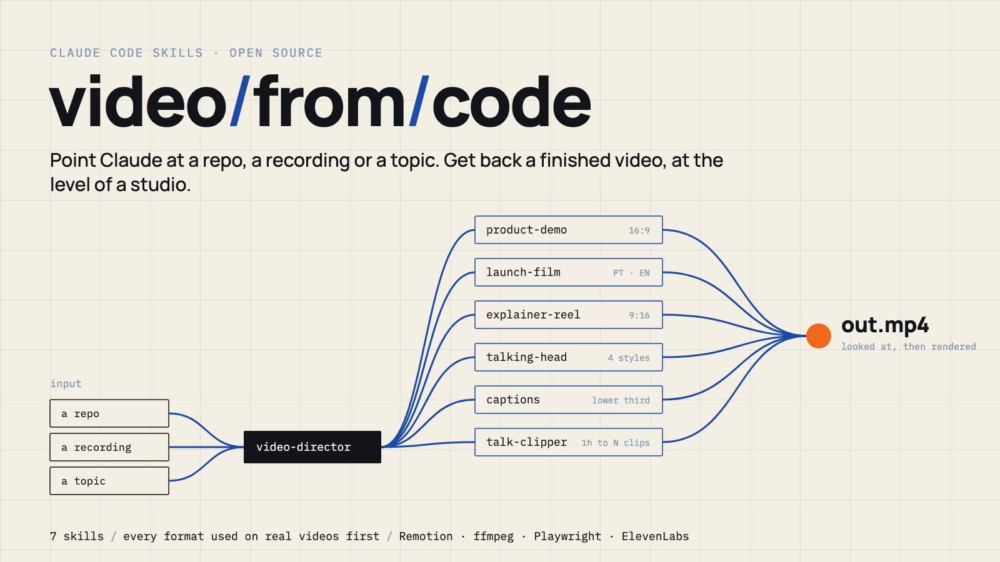
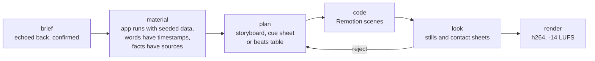
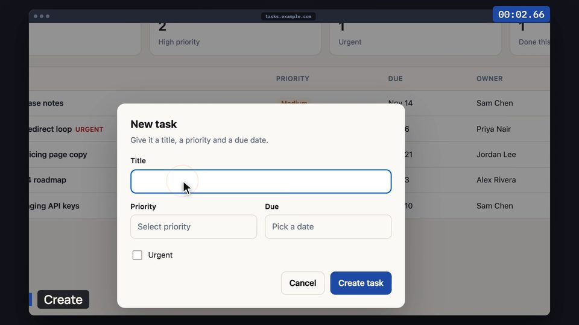
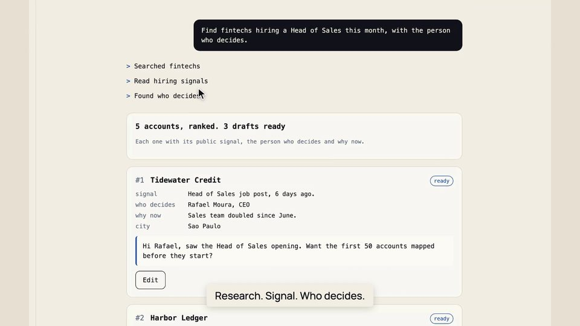
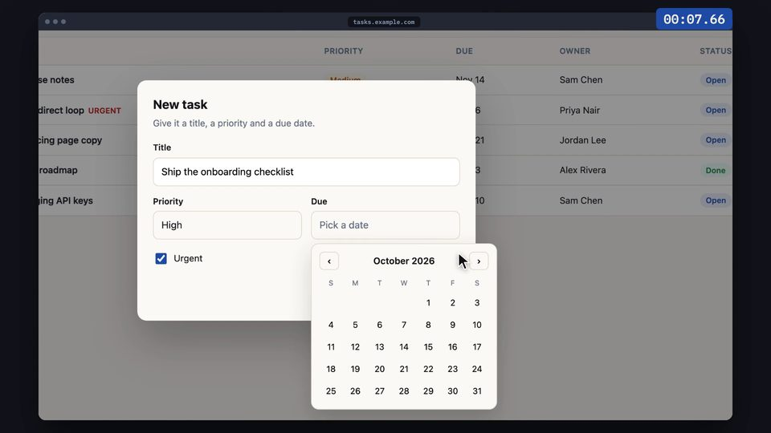
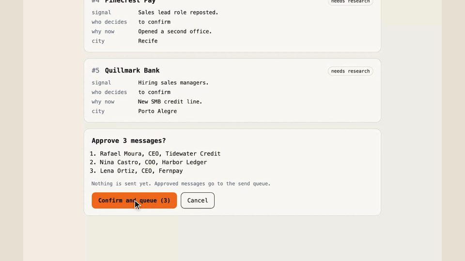
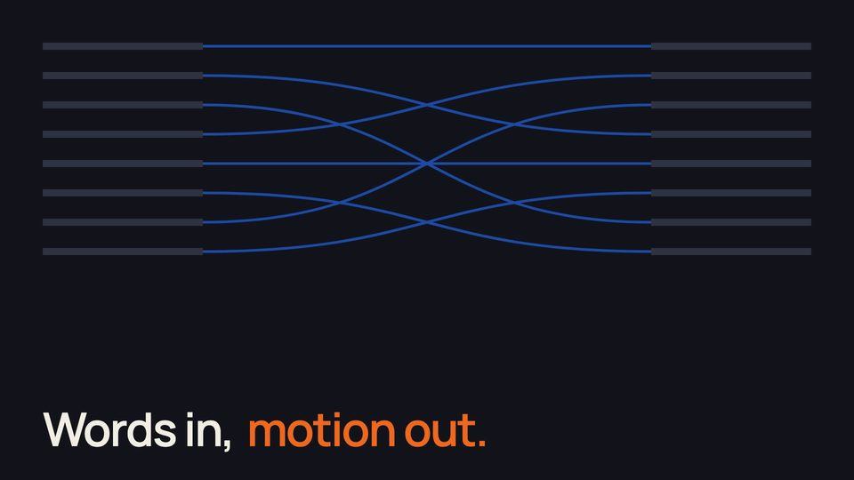
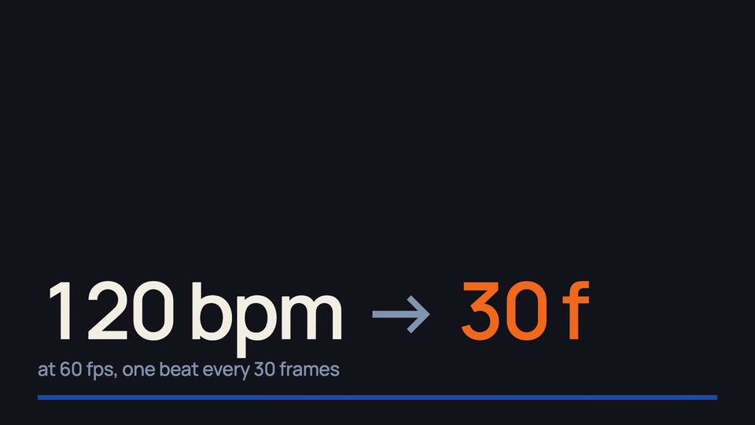
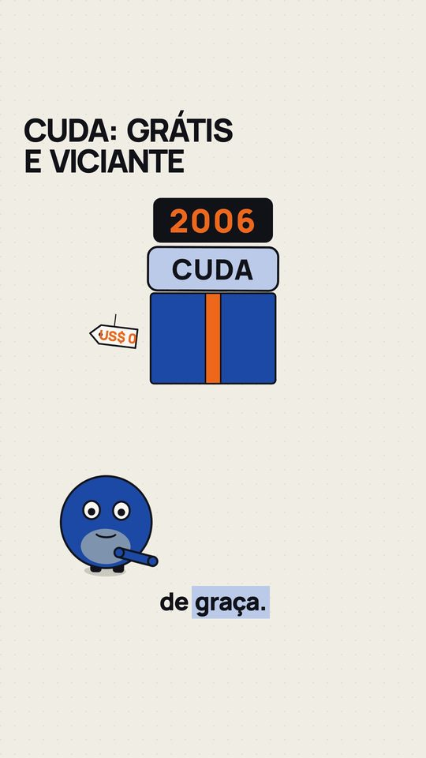
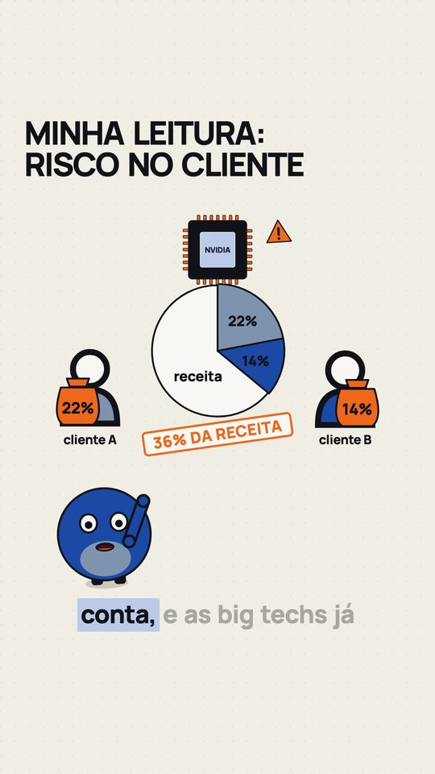

<p align="center">
  
</p>

<p align="center">
  <b>Seven Claude Code skills that turn a repo, a recording or a topic into a finished video.</b><br>
  You ask in plain language. Claude reads the material, picks the format, writes the video in React,
  looks at every frame before rendering, and hands you the MP4.
</p>

<p align="center">
  <a href="#quickstart">Quickstart</a> ·
  <a href="#the-skills">Skills</a> ·
  <a href="#how-a-video-gets-made">How it works</a> ·
  <a href="#gallery">Gallery</a> ·
  <a href="#requirements">Requirements</a> ·
  <a href="#license">License</a>
</p>

---

## Why this exists

Most "AI video" tools give you a template and a stock voice. These skills are the opposite: they
are the exact workflows used to ship real videos (a 4:41 product demo and its 1:24 commercial,
a bilingual launch film, a series of company-explainer reels, speaker reels, webinar cuts), written
down so Claude can repeat them on **your** product.

Nothing here is a promise. Every format was used on real videos before it entered the repo, and
every skill folder has a `TESTED.md` with the commands that were run, the output duration and
the loudness.

---

## The skills

| | Skill | Give it | Get back |
|---|---|---|---|
| 🎬 | **[`video-director`](skills/video-director)** | anything: "make a video of this app" | a confirmed brief, the right format, and the gates enforced until delivery |
| 🖱️ | **[`product-demo`](skills/product-demo)** | a web app you can run locally | a Screen-Studio-style demo: real UI frames, smooth cursor, click ripples, zoom on the action, chapters, optional voice |
| 🚀 | **[`launch-film`](skills/launch-film)** | a web app + public-domain archival footage | a cinematic launch film: the archive is the spine, a real browser recording lands on its beats, minimal cards, PT and EN |
| 🧠 | **[`explainer-reel`](skills/explainer-reel)** | a company, product or idea | a 9:16 reel, 45 to 58 s: sourced facts, hooky script, voice with word timing, drawn scenes that build and break, loop ending |
| 🎙️ | **[`talking-head`](skills/talking-head)** | a recording of someone speaking | four proven styles: pure motion, speaker + panels, mixed, and the 9:16 stage format |
| 💬 | **[`captions`](skills/captions)** | any spoken video | burned-in captions that never split an expression, highlighted terms, animated lower third |
| ✂️ | **[`talk-clipper`](skills/talk-clipper)** | a 1 h webinar, panel or call | topic clips per speaker, cut in the silences, captions and `.srt` |

Start with `video-director`. It asks what it cannot find, reads the material, and hands the work to
the right skill.

---

## Quickstart

```bash
# 1. clone
git clone https://github.com/zuckenbert/video-from-code ~/video-from-code

# 2. plug the skills into Claude Code
mkdir -p ~/.claude/skills
for s in ~/video-from-code/skills/*/; do ln -sfn "$s" ~/.claude/skills/"$(basename "$s")"; done

# 3. open Claude Code inside the project you want a video of
cd ~/my-product && claude
```

Then just ask:

> Make a 1 minute demo of this app, showing how a new user creates their first project.

> Turn this webinar recording into clips, one per topic, for LinkedIn.

> Explain how Stripe makes money in a 50 second reel, in Portuguese.

Each skill installs its own engine the first time it runs (a `setup.sh` inside the skill).

---

## How a video gets made



The rules that make the difference:

- **Real material only.** The demo runs your app locally with seeded data, never production and
  never an empty screen. Every number on screen was said, shown by the app, or has a source link.
- **Words drive motion.** In talking videos every effect is tied to a spoken word, not to a typed
  timestamp. In explainer reels every sentence must cause at least two physical actions.
- **A rejection gate before code.** The explainer beats table asks, scene by scene: does this read
  as a finished layout with things sliding in? Is anything static for more than 1.2 s? If yes,
  redo the plan before writing code.
- **Look before you render.** Contact sheets of every scene and every cut are opened and checked
  as images. Most bugs die here.
- **Ship-ready audio.** h264 MP4 with loudness normalized to -14 LUFS (talk clips -16).

---

## Gallery

<table>
  <tr>
    <td width="50%"><br><sub><b>product-demo</b> on the bundled sample app</sub></td>
    <td width="50%"><br><sub><b>launch-film</b> with placeholder archive</sub></td>
  </tr>
  <tr>
    <td></td>
    <td></td>
  </tr>
  <tr>
    <td><br><sub><b>talking-head</b>, style 1 (pure motion)</sub></td>
    <td></td>
  </tr>
</table>

<p align="center">
  
  
  <br><sub><b>explainer-reel</b>, reference episode with a placeholder narrator</sub>
</p>

All frames above were rendered by the skills in this repo, with their default theme.

---

## Requirements

| | Needed for |
|---|---|
| [Claude Code](https://code.claude.com) | everything |
| Node 22 (nvm recommended) | Remotion engines |
| ffmpeg | every skill |
| Python 3 | face tracking, alignment, captions, clipper |
| Playwright Chromium | product-demo, launch-film (installed by their setup) |
| `whisper-cpp` + a ggml model | captions (download command in the skill) |
| `ELEVENLABS_API_KEY` (optional) | voice, word-level transcription, sound effects. Without it: silent demos, local Kokoro voice for reels, local whisper |

Voices and captions work in **English and Portuguese**.

---

## Repo layout

```
skills/
├── video-director/   start here: brief, read the material, pick the format, gates
├── product-demo/     Playwright capture + Remotion film, with a sample app to test on
├── launch-film/      continuous recording on an archival clock + composition, PT and EN
├── explainer-reel/   facts, script, voice, beats, drawn scenes, loop; reference episode
├── talking-head/     face-following speaker engine, four styles, tools
├── captions/         captions + lower third with ffmpeg
└── talk-clipper/     long recording to topic clips
```

Each skill has a `SKILL.md` (what Claude follows) and a `TESTED.md` (proof it ran).

---

## License

MIT for everything in this repo (see [LICENSE](LICENSE)); `talk-clipper` keeps its own MIT notice.

**Heads up:** most skills render with [Remotion](https://www.remotion.dev), which is **not** MIT.
It is free for individuals and small teams; larger companies need a Remotion company license.
Check [remotion.dev/license](https://www.remotion.dev/license) before using these skills at work.
Fonts ship with their OFL licenses.
